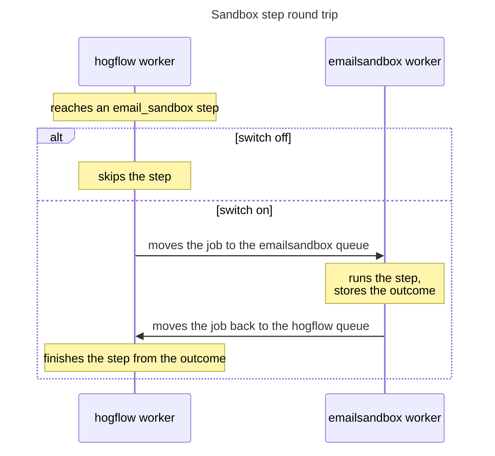

# Explainer

An explainer lets a reader who knows the system, but not the change, say
what the change does and why it works, in under a minute and without the
diff. It is one picture and four to six bullets. The picture shows the
mechanism; the bullets carry the words. Only a PR that is hard to
understand gets one.

## Steps

1. **Judge whether the PR needs one.** Read its diff and description as
   the reader above. It needs an explainer when what it does or why it is
   correct depends on something the diff does not show: work that crosses
   services, workers, or processes; an ordering, timing, retry, or
   concurrency rule; or state that changes over several calls. A new table
   or model, a UI change, a validator, a route that forwards a call, a
   config or policy change, or a rename reads straight from the diff and
   its description, and gets no explainer. When a set of PRs shares one
   mechanism, the PRs where it happens get the explainer, and the rest get
   none. Done when you can name what the diff hides from the reader, or
   you stop here and say the PR reads without one.
2. **Find the mechanism.** Read the PR's own change and the code around it,
   callers and callees, until you can write three sentences: where the
   change acts in the running system, what happened before and what happens
   now, and why the new behavior is correct or safe. A stacked PR's own
   change is its diff against its base branch; a merged PR's is its merge
   commit against the first parent. Done when the "why" sentence names the
   fact it rests on: a timing, a limit, a lock, an ordering, a cache, stored
   state, or another service's behavior.
3. **Pick the form** from the mechanism, in the table below. Done when you
   can name the form and the one thing a reader sees in it that the bullets
   cannot show as fast. When nothing qualifies, write the bullets alone.
4. **Draw it.** Draw the data the change moves: the polls, the rows a query
   reads, the calls, the states, the time a caller waits. When the change
   alters that data, draw before and now in the same form, one above the
   other, so the difference is the picture. Name parts with the code's own
   names.

   The picture is sparse: a title of two to four words, short labels, and
   at most two lines of note under it. Every sentence goes in the bullets.
   Arrows and messages carry the labels; a Mermaid note holds a few words.
   Write each label as a short phrase with its verb, such as "moves the job
   to the emailsandbox queue", and each flowchart decision as a question,
   such as "Is the step id already stored?". Draw the one path or state the "why" rests on, and leave
   error codes, guard lists, and every other branch to the bullets and the
   diff. Give a Mermaid diagram its title in frontmatter
   (`---` / `title: <title>` / `---`), and shade a span with
   `rect rgba(<r>, <g>, <b>, 0.15)` so it reads in dark mode too.

   Render with `bun <this skill's directory>/scripts/render.ts <file>`. It
   takes a Mermaid `.mmd` or an `.html` copied from
   [canvas.html](canvas.html), writes a PNG beside it at 2x, and fails when
   text overflows its box. Read the PNG. GitHub draws a Mermaid block in its
   own theme, so for Mermaid the PNG checks layout only. Done when no text
   is clipped or overlaps, and a reader who skips the note still sees what
   changed.
5. **Write the bullets** in the template below: one fact per bullet, under
   25 words, in the code's own names. The explainer owns the mechanism. When
   the PR's description already explains it, move those facts into the
   bullets, and leave the rest of the description with the visible effect,
   the switch, and the risks. Done when every slot of the template is filled.
6. **Unslop.** Read the `unslop` skill (`~/.agents/skills/unslop/SKILL.md`)
   and apply every rule to the bullets and to every label in the picture.
   Where another writing skill disagrees, `unslop` wins. Then hide the
   picture and read the bullets alone, as the reader above. Done when that
   reader can say what the change does and why it works.
7. **Place it.**
   - **PR description:** add it as `### How it works` at the end of the
     section that describes the change. Edit the live body, keep everything
     else in it, and read it back after the push. A Mermaid picture goes in
     as a `mermaid` code block, which GitHub renders. Upload a PNG by the
     repository's own route when its description skill names one.
     Otherwise run `gh pr edit --body-file <body> --attach <png>`, with the
     body referencing the PNG by the same path. The alt text is the title.
     A picture from a private repository never goes to a public asset
     repository.
   - **Chat reply:** show the PNG, or the Mermaid block, and the bullets.

   In a public repository, the picture and the bullets carry config values
   and local benchmark numbers only. Production numbers, pod counts,
   hostnames, account and customer names, credentials, and internal metrics
   stay out.

## Forms

| The mechanism | The form | Drawn with |
| --- | --- | --- |
| Calls between services or workers, in order | Sequence diagram | Mermaid `sequenceDiagram`; `alt` for a switch |
| A path that branches on conditions | Flowchart: an exit for each outcome the "why" rests on, the rest folded into one exit | Mermaid `flowchart` |
| A record or object that moves between states | State diagram | Mermaid `stateDiagram-v2`; the canvas when its loops tangle |
| How often something runs, or who waits how long | Timeline: ticks, or bars on one time axis | Canvas |
| Which rows, keys, or items a query or loop touches | The items as small squares, the touched ones outlined | Canvas |
| A quantity that builds up and drops | A line over time, before and now | Canvas |

When the parts and their order are the point, draw a sequence diagram or a
flowchart, and keep it sparse.

## Template

```markdown
### How it works

<picture>

- This PR acts on <the function, step, or query it changes, or its place in the shared picture>.
- Before, <what happened, and what it cost>.
- Now, <what happens with this change>.
- <why it works: the fact it rests on, then one bullet per guard, up to three>
```

When several PRs of a set need an explainer and act on one path, they
share one picture of it, with each PR's number on its place: a shaded span
of a sequence, an outlined state. Each of those PRs carries that picture,
and its first bullet names its place, such as "the upload span (#1234) of
the flow above".

## Example

A worker hands a step to a second worker and takes it back, so calls in
order are the mechanism: a sequence diagram.

````markdown
### How it works



- This PR acts on the `email_sandbox` step of a workflow run.
- Before, the `hogflow` worker had no handler for `email_sandbox`, so a run that reached one failed.
- Now, `SandboxEmailActionHandler` moves the job to the `emailsandbox` queue. That worker runs the step, stores the outcome, and hands the job back.
- The job carries the outcome, so `hogflow` finishes the step from it and never sends twice.
- On `emailsandbox` the executor stops after one action, so no other step type runs there.
````
