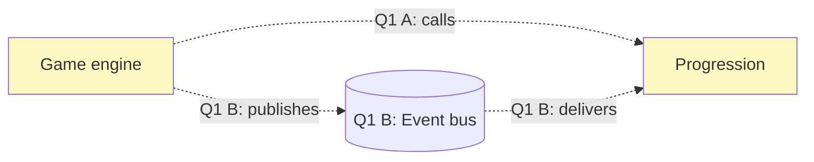

# Architecture

Shape a change in conversation: `grilling` rounds, one diagram per round, down a C4-like ladder from context to contracts. The conversation is the design. Each diagram makes one rung concrete enough to argue with, and the user decides every fork before the next rung is drawn.

Call the Skill tool with "grilling" for the round format and the frontier rule, with "codebase-design" for the vocabulary (**module**, **interface**, **seam**, **adapter**, **depth**, **leverage**, **locality**; use these terms exactly), and with "domain-modeling" for the domain terms and the ADR bar. Cast subagents per the model selection policy in the user's agent instructions, when one exists; otherwise use the runtime defaults.

## Ground

Dispatch research subagents to map what the change touches: the modules, the seams and the contracts at them, and the hot paths. Read `GLOSSARY.md` and the ADRs in the area, so the rounds use the domain's names and name any settled decision they reopen.

Done when every module and every contract you will draw is linked to a real `path:line` that you opened and checked.

## Rounds

A round is the rung's diagram plus the frontier questions, nothing else. Open with one line that names what the last answers changed in the diagram. Draw the diagram, then ask every question whose prerequisites are settled, in the exact `grilling` format: numbered ❓ questions, each with a ➡️ recommended answer. The round in full is the turn's final reply: put links to the ticket or branch in one closing line, and close by asking the user to accept all recommendations, accept with changes, or discuss first.

Descend the ladder one rung per round:

1. **Context**: a change map. The actors, the external systems, and the modules the change touches. Ask about scope: which modules are in, which actors drive the change.
2. **Modules and seams**: the same flowchart, zoomed in to the modules and the dependencies between them. Draw each open fork as alternatives in the same diagram, marked as **The living diagram** describes. Ask who owns what, which way each dependency points, and where each seam goes. When a seam stays contested after its round, design it twice: dispatch the subagents from `DESIGN-IT-TWICE.md` in the `codebase-design` skill and draw their interfaces as the alternatives in the next round's diagram.
3. **Call paths**: one sequence diagram per key path: the main read, the main write, and the most important failure. Ask what each participant knows, where a step can fail, and what happens when it does.
4. **Contracts**: the interface at each locked seam as code in the repo's language, with its invariants, error modes, and performance characteristics. Ask what each caller must know and what stays behind the seam.

Each answer reshapes the design tree. Lock a fork yourself only when the code or an ADR settles it, and say so in the recommendation; the user can reopen it.

## The living diagram

Each rung has one diagram that lives across its rounds: rungs 1 and 2 share one flowchart, and each key path of rung 3 keeps its own sequence diagram. Every round redraws that diagram with the answers applied. An accepted suggestion turns locked, a rejected one goes away, and the frontier's new guesses appear.

A flowchart marks two things, and its legend explains both:

- **Fill** is the change: **new**, **changed**, **untouched**, or **external**.
- **Border** is the decision: solid for **locked**; dashed for a **suggestion**, with its question number in the label, such as `Q2 Selection API`; dotted for an **open fork**, its alternatives labelled `Q3 A` and `Q3 B`. Every suggestion and every fork has its question in the round.

Define the borders as `classDef suggested stroke-dasharray:6 4` and `classDef fork stroke-dasharray:2 3`, and give a node both marks with `class Api new,suggested`. Draw a suggested or alternative edge as `-. "Q3 A: calls" .->`. In a sequence diagram, put the question number in the label of each suggested message.

Facts are yours to find: dispatch a subagent for anything the environment can answer. Decisions are the user's.

Done when the frontier is empty: every seam locked, every key path drawn, every contract written, and the user has confirmed the shared understanding.

## Render the diagram

Diagrams are Mermaid. Where the round appears decides how the diagram renders:

- **T3 Code** (`T3CODE_HOME` is set): before the final reply, render the round's diagram inline with `html_render`, as one small self-contained page that holds only that diagram. Preview it with `html_preview` first to get its height. The page is a `<pre class="mermaid">` block plus one module script that imports Mermaid from `https://cdn.jsdelivr.net/npm/mermaid@11/dist/mermaid.esm.min.mjs` and calls `mermaid.initialize({ startOnLoad: true })`; the tool's own description covers the page style. The final reply then carries the questions.
- **GitHub ticket**: post the round as a comment with the diagram in a fenced `mermaid` code block, which GitHub renders.
- **Elsewhere**: put the fenced `mermaid` block at the top of the round.

## Worked example

A rung 2 round with one open fork, drawn as two alternatives:

❓ **Q1** - **Engine to progression dependency**: A has the engine call progression directly, so the engine knows progression exists. B has the engine publish events on a bus that progression subscribes to. Which way should this dependency point?

➡️ B. Progression is one of several listeners for engine events (achievements and analytics are next), so two adapters already justify the seam, and the engine stays free of every consumer.

## Capture

Write `docs/architecture/<name>.md` once, at capture; during the rounds the thread and the ticket comments hold the design. The file holds the question, the final diagram of each rung, and the locked contracts with their invariants, error modes, and performance characteristics. Then record one ADR per locked seam that passes `domain-modeling`'s three-part bar (hard to reverse, surprising without context, a real trade-off), in the format of `ADR-FORMAT.md` in the `domain-modeling` skill. The file becomes the interface section of the spec or implementation ticket that follows.

For a Wayfinder ticket, the resolution comment links the file and lists every locked decision.

Done when the file holds every final diagram and contract, and every locked seam has its ADR or a one-line note that it misses the bar.
