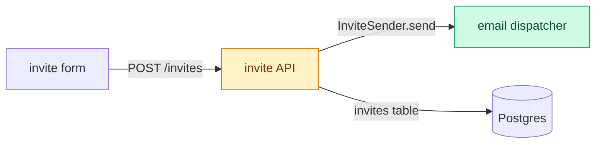

# Implementation views

Add a diagram only when the change alters a flow: which modules call each
other, in what order, or how data moves between them. Draw a Mermaid
`flowchart LR` or `sequenceDiagram` of the modules on that path and the seams
that connect them: the interface, call, event, or table one module uses to
reach the next. Label each edge with its seam, and colour new and changed
modules and seams. A change that keeps the flow intact gets no diagram; its
screenshots, output, and tests carry the proof.

For a mechanism that a flow diagram does not explain, choose the smallest
other view:

| Question | View |
| --- | --- |
| How does an algorithm decide? | Short pseudocode |
| What changes inside an existing structure? | Small diff sketch |

Place the view next to the sentence it explains. Include only the modules,
seams, calls, and states needed to understand the change. UI screenshots
remain the evidence of visible behavior.
