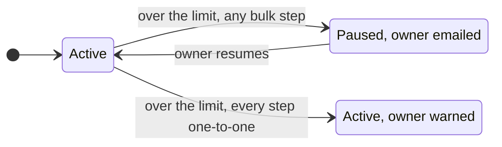
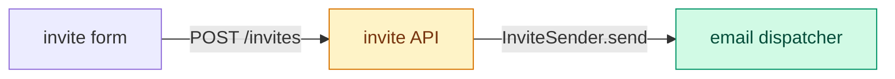

# Picture

Every Changes section has one picture slot. The kind of change fills it.
Put it after the shape and its `Rejected:` line, open, never in a collapsed
block. Show only the modules, calls, and states a reader needs.

| Kind of change | The slot holds |
| --- | --- |
| Calls over time, such as a retry, a queue, or a request across services | A Mermaid `sequenceDiagram` |
| Branches, such as a rule that sends work one of several ways | A Mermaid `flowchart` |
| State, such as a status a record moves through | A Mermaid `stateDiagram-v2` |
| Waits, such as a rollout order or a delay before a step | A Mermaid `timeline` |
| A new or changed module path, such as a new seam between modules | A Mermaid `flowchart LR`, each edge labeled with its seam |
| UI | One screenshot per changed state, each under a one-line label, or the walk video; capture them as [UI evidence](ui-evidence.md) says |
| Config, copy, or a table | `No picture: the diff shows it whole.`, then the diff in a `diff` block when it is short |

The mechanism picks the form, not the size of the change. Draw the new
behavior, and color what is new or changed:

A before and after table hides the mechanism; draw the new behavior instead.
For a mechanism no diagram explains, such as how an algorithm decides, use
short pseudocode in the slot.

## The repository's own rule

When the repository's description skill or template has a stricter rule on
diagrams, such as diagrams only for flows across services, its rule wins.
The slot then says why there is no picture, such as
`No picture: this repository draws diagrams only for flows across services.`
